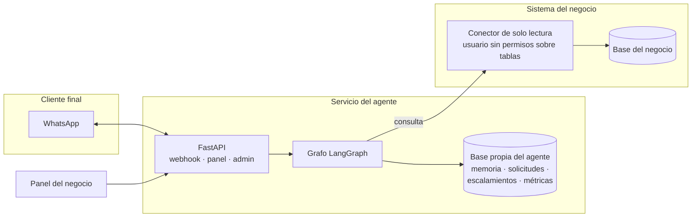
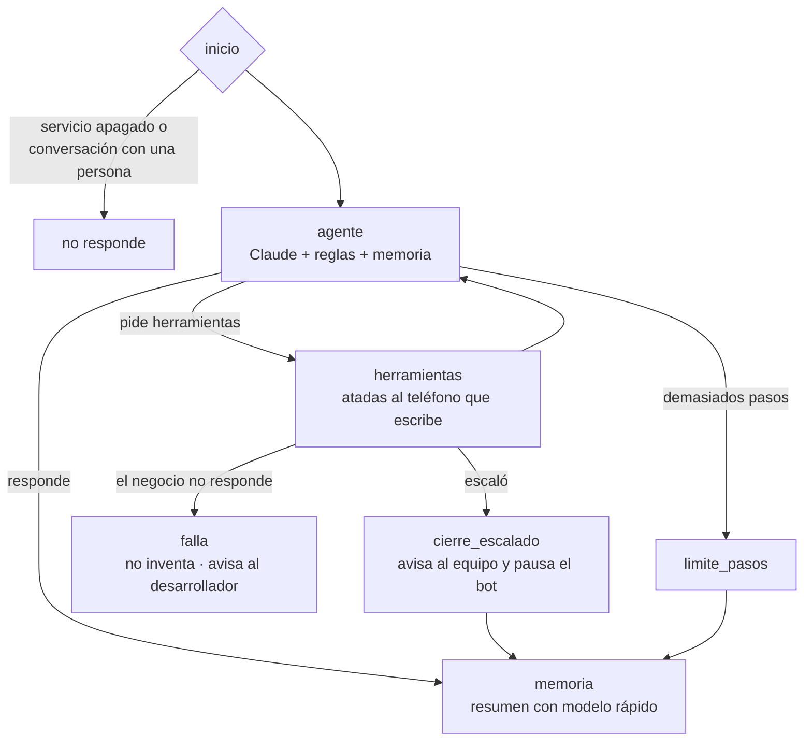

# Agente de ventas y atención por WhatsApp

Agente de IA que atiende clientes de un comercio por WhatsApp: consulta inventario y pedidos **en vivo**, recuerda a cada cliente, registra solicitudes para que el equipo las confirme y **pasa la conversación a una persona** cuando hace falta.

Es un servicio **independiente** que se conecta al sistema de un negocio en modo solo lectura, y se desconecta sin dejar rastro. Nació para un negocio real de importaciones en Colombia. Este repositorio trae un negocio de **demo con datos ficticios** para correrlo sin base de datos.

**Stack:** Python · LangGraph · Claude API (tool use) · FastAPI · WhatsApp Cloud API · PostgreSQL / SQLite · SQLAlchemy

## Arquitectura





| Pieza | Dónde | Qué hace |
|---|---|---|
| Orquestación | `app/grafo.py` | Grafo de LangGraph con rutas para responder, escalar, fallar y cortar bucles |
| Herramientas | `app/herramientas.py` | `buscar_productos`, `consultar_mis_pedidos`, `consultar_mi_saldo`, `registrar_solicitud`, `escalar_a_humano` |
| Conector | `negocios/<negocio>/conector.py` | Única puerta a los datos del negocio: 4 lecturas, sin escrituras |
| Base del agente | `app/almacen.py` | Memoria, solicitudes, escalamientos, eventos y estado del servicio. SQLite o Postgres propio |
| Memoria corta | checkpointer de LangGraph | Últimos 12 mensajes de la conversación, por teléfono |
| Memoria larga | `almacen.memoria` | Resumen de máximo 4 frases por cliente, escrito por un modelo más barato solo cuando hubo algo relevante |
| Escalado a humanos | `escalar_a_humano` + panel | Pausa el bot, avisa al equipo con un resumen y espera a que una persona devuelva la conversación |
| Panel | `app/panel.py` | El negocio ve solicitudes, conversaciones escaladas y métricas, y puede pausar el agente |
| Interruptor | `/admin/servicio` | El proveedor suspende el servicio o fija la fecha de fin de una prueba |
| Reglas | `negocios/<negocio>/negocio.yaml` | Lo que aprueba el dueño del negocio: reglas, cuándo escalar, mensajes fijos |

## Decisiones de diseño

- **Separado del sistema del negocio.** El agente guarda todo en su propia base. En el negocio solo se instala un esquema con funciones de lectura y un usuario que no puede leer tablas ni escribir (`default_transaction_read_only`, `statement_timeout` de 5 s, máximo 5 conexiones). Un script lo instala y otro lo quita por completo.
- **Lo que el agente no debe hacer, no puede hacerlo.** Las herramientas se crean por conversación y quedan atadas al teléfono de quien escribe: el modelo nunca recibe ni elige un teléfono. Aunque un mensaje lo engañe (*prompt injection*), no hay herramienta que devuelva datos de otra persona, costos o listas internas, y la base rechaza cualquier escritura.
- **El agente no crea pedidos ni toca pagos.** Registra una solicitud que una persona confirma. Descuentos, pagos y devoluciones siempre escalan.
- **Nunca inventa.** Precios, inventario, estados y saldos salen de herramientas. Si el negocio no responde: reintenta 3 veces con espera creciente; si sigue caído, responde un mensaje fijo, escala y avisa al desarrollador (un aviso cada 10 minutos por tipo de error).
- **Interruptor en tres niveles.** El negocio puede pausarlo desde el panel. El proveedor puede suspenderlo o dejar que venza la prueba, y el negocio no puede reactivarlo. Apagado, no gasta IA ni consulta el sistema del negocio.
- **Costo controlado.** Historial recortado, memoria con modelo rápido solo cuando se usaron herramientas, máximo de pasos por mensaje, límite de mensajes por número y registro de tokens.
- **Webhook seguro.** Firma HMAC de Meta, descarte de reintentos duplicados, respuesta inmediata con el trabajo en segundo plano. Panel con usuario y clave, protección CSRF y texto del cliente escapado.

## Correrlo

```bash
pip install -r requirements.txt
cp .env.example .env          # poner ANTHROPIC_API_KEY
python chat.py                # chat en la terminal con datos de demo
```

Clientes de demo: `3000000001` (tiene pedidos y saldo) o cualquier otro número (cliente nuevo).

Servidor con WhatsApp y panel:

```bash
uvicorn app.whatsapp:app --port 8000
# Webhook en Meta: https://<tu-dominio>/webhook   ·   Panel: https://<tu-dominio>/panel
```

Suspender o fijar una prueba (proveedor):

```bash
curl -X POST https://<tu-dominio>/admin/servicio -H "Authorization: Bearer $ADMIN_TOKEN" \
     -H "Content-Type: application/json" -d '{"prueba_hasta": "2026-11-15"}'
curl -X POST https://<tu-dominio>/admin/servicio -H "Authorization: Bearer $ADMIN_TOKEN" \
     -H "Content-Type: application/json" -d '{"suspendido": true}'
```

## Pruebas y evaluaciones

```bash
pytest                        # flujo, escalado, fallas, interruptor, seguridad, webhook y panel (sin IA ni red)
python evals/correr.py        # 14 casos con el modelo real: normales, difíciles, escalado y prompt injection
```

Las pruebas usan un modelo falso con guion para verificar la orquestación de forma determinística. Las evaluaciones se corren antes de cada cambio de reglas, prompt o modelo y guardan el detalle en `evals/resultados_*.json`.

## Agregar un negocio

1. `negocios/<nombre>/negocio.yaml` con sus reglas (copiar el de `demo`).
2. `negocios/<nombre>/conector.py` con una clase que cumpla `app/conector.Conector` y una función `crear_conector()`.
3. Correr con `NEGOCIO=<nombre>`.
